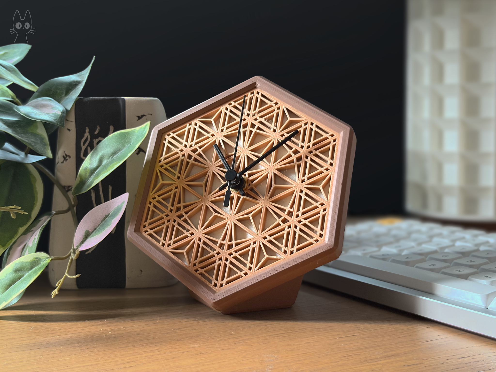
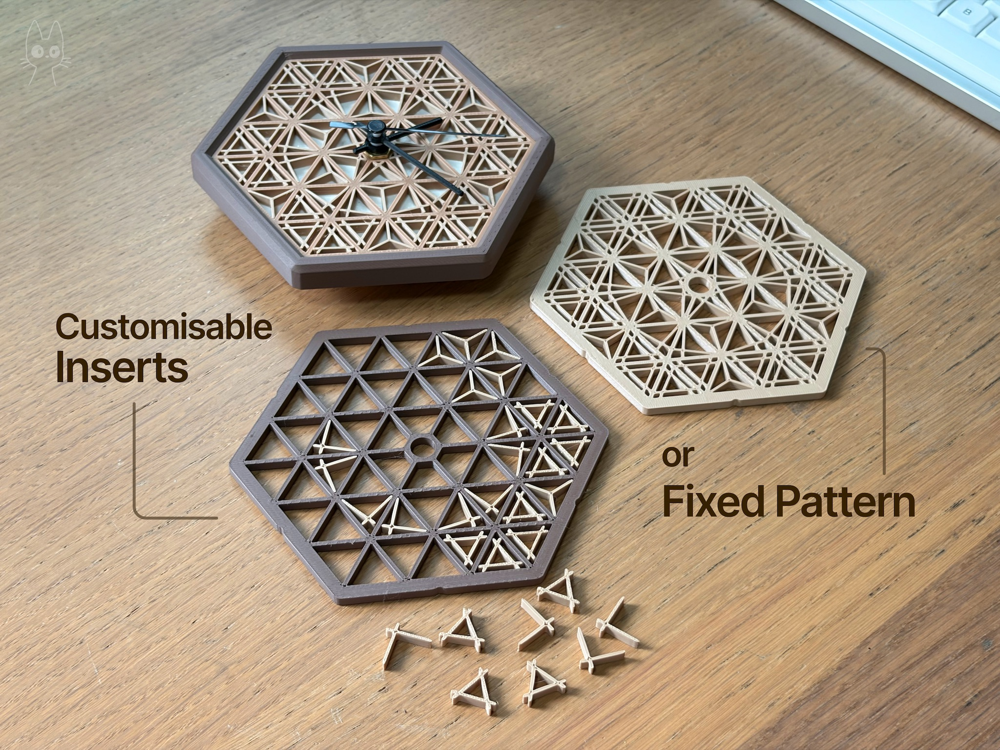
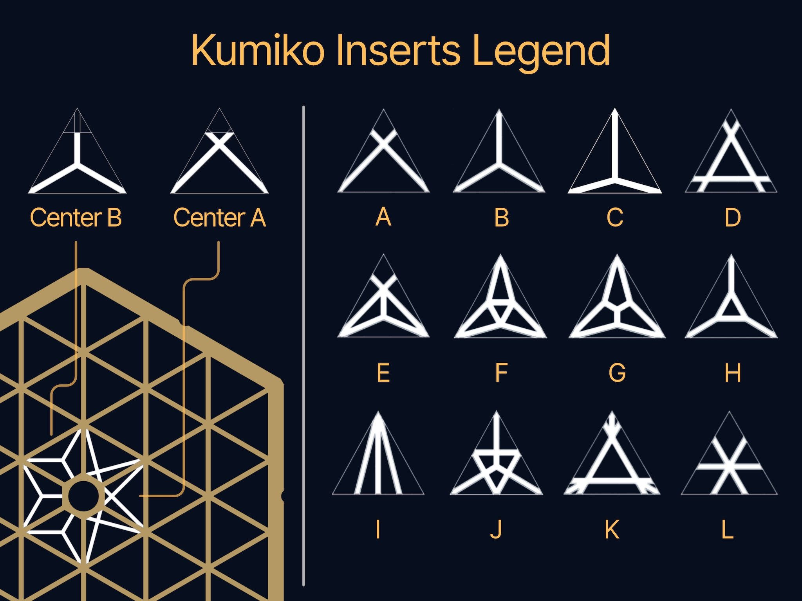
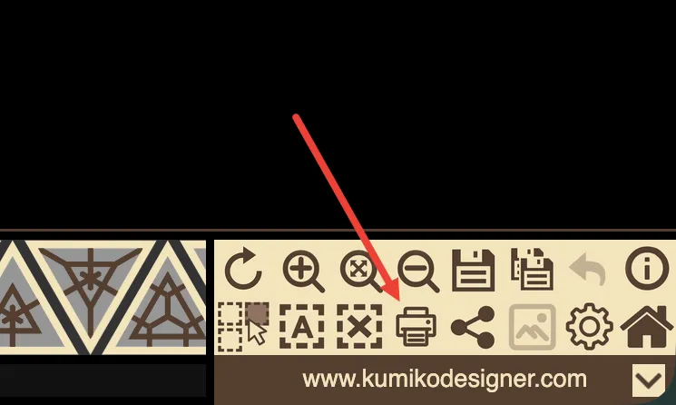
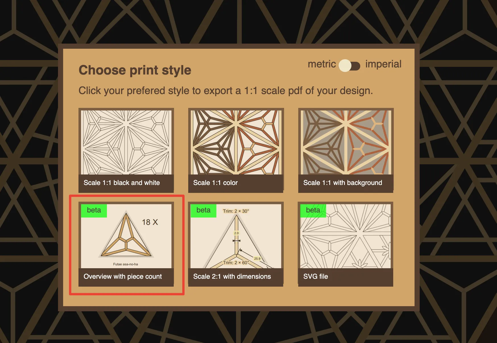
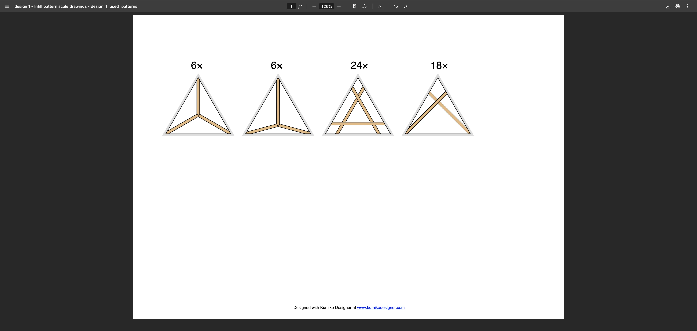
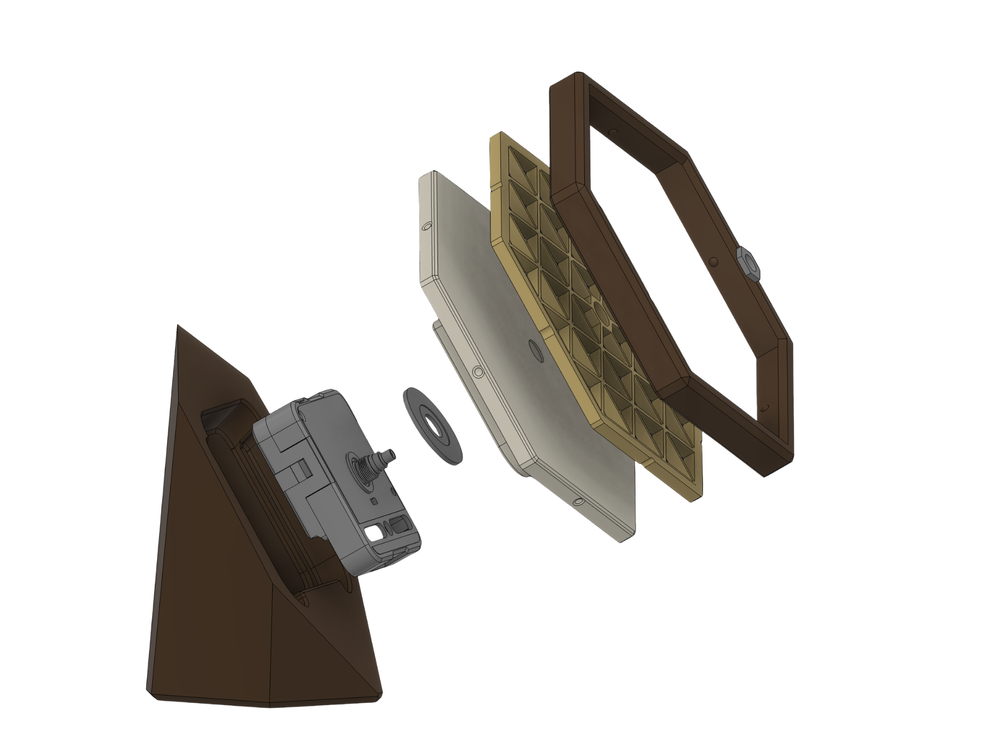

  

<h1 align="center">
  <a href="https://makerworld.com/en/models/3623808">Kumiko Desk Clock</a>
</h1>

A desk clock inspired by the traditional Japanese woodworking art of **Kumiko**, designed for Bambu Lab's Clock Components Kit.

You can create your own completely custom pattern, or use my pre-designed pattern for a simpler and faster print.

## Bill of Materials (BOM)

| Part / Component         | Quantity | Link                                                                      | Price (USD)              |
| :----------------------- | :------: | :------------------------------------------------------------------------ | :----------------------- |
| Clock Components Kit 011 |    1     | [Bambu Lab](https://store.bambulab.com/products/clock-components-kit-011) | $8.00, on sale for $6.40 |
| 3D Printing Filament     |    1     | Any                                                                       | Varies                   |

## Kumiko Versions

There are three versions of the Kumiko design to choose from:

### Customisable Kumiko Frame

This version consists of a separate frame and individual inserts that you can arrange to create your own Kumiko pattern.

- **Fully customisable.**
- Supports **multicolour combinations** by printing the frame and inserts in different colours, or even printing different inserts in different colours.
- Includes **12 different insert designs** (A–L) to create your personalised clockface.
- **More time-consuming** to print and assemble, as every insert needs to be printed and inserted individually. It takes around 15 minutes to assemble in my experience.

### Fixed Kumiko Pattern

A pre-designed geometric pattern that I've put together, printed as a single piece.

- **Much simpler and quicker to print.**
- No need to individually print or assemble inserts.
- Ideal if you like the included pattern and don't intend to customise it yourself.

### Premade Pattern – Inserts

This version uses the exact same pattern as the fixed design, but separates the frame and inserts into individual parts.

For those who want the multicolour printing ability of the inserts, while keeping the premade pattern. It saves time, as all the inserts required for the premade pattern are already included in the print profile.

## Creating Your Own Kumiko Pattern

One of the best things about this model is that you can create virtually endless combinations of Kumiko patterns. Here's how to design and print your own!

### Step 1 – Design your pattern

1. Go to [kumikodesigner.com](https://kumikodesigner.com).
2. Select **Hexagon Framed Panel**.
3. Set the **Edge** parameter to **3**.
4. Start designing your pattern using the available inserts.

Make sure that every insert you use is available in this model. There are 12 supported insert designs, labelled A–L.

#### Centre Inserts

The 6 inserts surrounding the clock mechanism are slightly different from the regular inserts, to use the space needed for the mechanism. There are two dedicated designs to choose from.

The website has quite a wide range of insert designs, so I have only designed some of the more frequently used ones.

### Step 2 – Export your design

Once you're happy with your pattern:

1. Click **Export printable design**.

2. Select **Overview with piece count**.

This will generate a PDF showing your completed pattern and the quantity of each insert required.

If your PDF includes the six centre positions in the quantities of a regular insert (A–L), remember to subtract 6 from that insert's total. You will need to print these six pieces using either **Center A** or **Center B**.

Choose either Center A or Center B from the provided print plates and print 6 of your chosen design separately.

- For example: If your PDF says you need 24 of insert A, but 6 of those are used in the center, you'll need to print:
  - 18 x Insert A
  - 6 x Center A

### Step 3 – Prepare your inserts for printing

1. Open the **Kumiko Inserts** print profile from [MakerWorld](https://makerworld.com/en/models/3623808) in your slicer.
   - Alternatively, you could also download the print profiles from the **"model/3mf"** folder in this repo!
2. Each of the 12 insert designs and 2 centre insert designs has its own dedicated plate.
3. Find the plates corresponding to the inserts in your PDF.
4. Clone each insert until you have the required quantity.

**I recommend a Textured PEI plate for printing the inserts,** as they detach from the Engineering bed / Smooth PEI quite easily in my experience. Maybe it'll work on a smooth plate if you clean it really thoroughly lol

## Print Details

### Print Profiles

**Kumiko Clock**

- Plate 1: Kumiko Pattern
- Plate 2: Backplate
- Plate 3: Frame
- Plate 4: Stand
- Plate 5: Clock Hands

**Kumiko Frame & Inserts**

- Plate 1: Kumiko Frame
- Plate 2-15: Individual Kumiko Inserts (Center A, Center B, A–L)

**Premade Design – Inserts (Contains all the inserts needed for the premade design.)**

- Plate 1: Kumiko Frame
- Plate 2: Inserts

### Recommended Settings

- **Material:** PLA recommended. The filaments used in the photos are Bambu Lab's Latte Brown, Caramel, Dark Brown, and Ivory White PLA.
- **Walls/Perimeters:** 3 enabled Arachne walls for better fidelity on the inserts and pattern.

### Printing Tips

- **Restated from earlier:** I recommend using the **Textured PEI plate** for printing the inserts, as they detach from the Engineering Plate quite easily in my experience.
- The inserts and the frame have a very tight tolerance of **0.075 mm**. This was a snug fit in my testing, but results may differ depending on your printer and filament. I suggest printing a few inserts first to test the fit before printing all of them.
- If the inserts are too snug, try scaling them down slightly (in increments of around 0.1%) until you get a good fit. If they're too loose, scale them up instead.

## Assembly

Assembly is pretty straightforward. The frame has a snap-fit connection to the backplate which sandwhiches the kumiko frame in between. The clock kit and protrusion at the back plate sits in the stand and holds the clock upright.

Happy printing!
